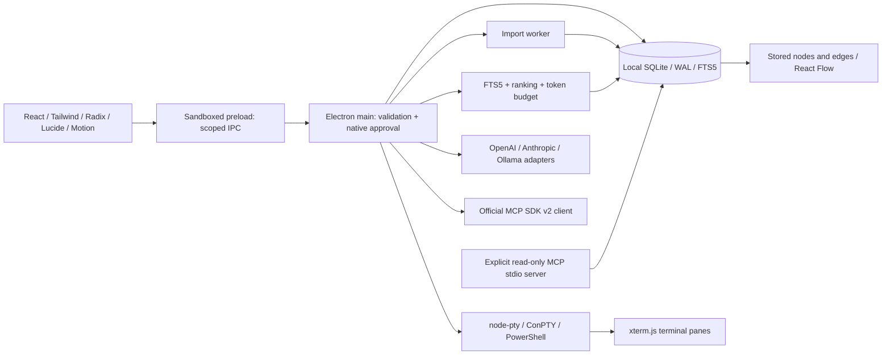
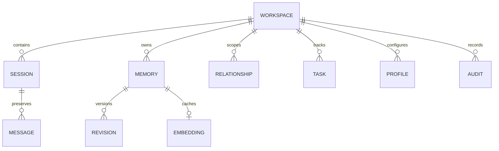

# Architecture

MNEMO is a single-user local desktop app. Its trusted main process owns storage, native terminals and network clients. Its untrusted renderer owns presentation and invokes an explicit preload allowlist.

## Processes

`bootstrap.cts` is a CommonJS Electron entry point. It waits for readiness through a callback and loads the bundled CommonJS main process. Avoid entry-module top-level awaits of `app.whenReady()`. The main bundle uses esbuild with external npm packages; the read-only MCP server and worker also compile to native ESM with TypeScript.

The sandboxed CommonJS preload exposes only `call` for known operations and a terminal event subscription. The renderer has no Node integration, filesystem module or network credential access. Main validates the actual webContents and main frame, then validates each request's arguments. Electron navigation, popups, webviews and permission requests are denied. CSP excludes external scripts, objects and renderer API traffic; loopback Vite connections are permitted for development.

An import worker opens the same SQLite file. WAL and a busy timeout coordinate access; an import is one atomic transaction. The main process stays responsive while messages are written. Preview parsing (20 MiB cap), retrieval, archive restoration (100 MiB cap) and some export construction are currently synchronous. These are explicit optimization targets, not a claim of fully background indexing.

## Database

The authoritative schema is `src/main/schema.ts`; its first migration is also distributed as `migrations/001_initial.sql`. `schema_versions` records applied versions. All user SQL parameters are bound. A Drizzle schema and SQLite-proxy adapter handle renderer memory listing; native prepared queries handle FTS5, transactions and other entities.

| Table | Purpose |
|---|---|
| workspaces | Project identity, path and explicitly chosen environment |
| sessions | Provider/external identity, metadata, source, tags and unverified summary |
| messages | Append-only transcript messages; ordinal and content hash |
| memories | Categorized knowledge, source, verification, timestamps and version |
| revisions | Prior memory snapshots |
| relationships | Workspace-scoped typed edges between actual records |
| tasks | Objective, requirements, status, evidence, blockers and linked IDs |
| profiles | User instructions, allowed-tool metadata, knowledge types and verification |
| audit | Workspace action timeline, entity IDs and redacted details |
| settings | Appearance, encrypted credential blobs and scoped integration/chat settings |
| embeddings | Model, content hash and cached numeric vectors |
| memory_fts | FTS5 index updated transactionally by insert/update/delete triggers |

Workspaces cascade deletes to owned records; foreign keys cascade revisions/messages/vectors. Relationships may connect heterogeneous entity types, so endpoints are checked in the Store instead of using one foreign key. Query indexes support workspace, timestamp, status and transcript joins.

## Retrieval and graph

Retrieval combines bounded FTS candidates, optional cosine matches, manually pinned records and one-hop stored neighbors. Ranking considers verification, recency and relationship evidence. Exact content hashes deduplicate selected records. Whole records fit the estimated budget; content is not truncated mid-constraint. JSON records retain source references and IDs. Stored contradictions are reserved in the context header and visible in diagnostics.

The graph represents actual projects, loaded sessions, memories and tasks. Its edges come exclusively from stored relationships. Stable grid layout, bounded rendering, category filters, focus and minimap keep the preview usable. Larger graph clustering, force-directed layout and fully virtualized lists remain roadmap work.

## External transmission boundary

Only main-process adapters issue AI/embedding requests. Data destinations are validated; HTTPS is required except loopback HTTP. Redirects are rejected. API JSON responses have a 10 MiB bound and requests have timeouts/cancellation. Provider response text is redacted before storage. Changing provider origin/kind clears the old credential unless a new key was supplied.

MCP connection approval is separate from operation approval. A stdio process runs as the OS user, so a renderer sandbox does not sandbox the selected server. MNEMO does not automatically select, invoke or trust tools, and chat has no tool loop.
