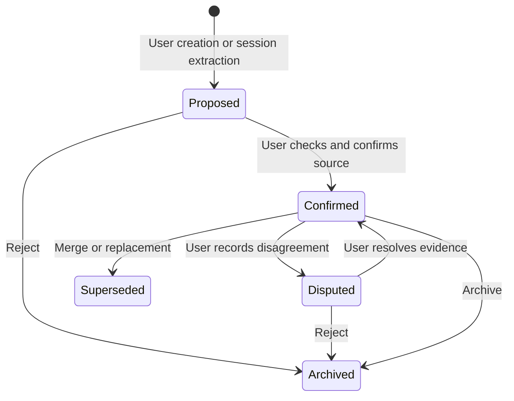

# Memory engine

## Lifecycle



All five statuses are editable. Confirmed is a user assertion; it is not automatically assigned to a model response. Every memory has an ID, workspace, title/content, category, source, tags, version, timestamps and confidence. Confidence is currently a simple status-derived value (100 confirmed, 50 otherwise), not a statistical probability. Confirmation sets `verifiedAt`; editing confirmed content renews its verification timestamp because the user explicitly chose that status in the editor.

Saving an existing record captures its previous JSON snapshot in `revisions`, increments its version, updates FTS triggers, invalidates its vector and adds an audit event. Archive/reject preserves evidence and history. Merge creates a Proposed combined record, preserves both sources, marks the origin Superseded and stores a real `superseded by` relationship. Restored archives retain original version and verification metadata but remap all identifiers.

## Import formats

Canonical transcript envelope:

```json
{
  "format": "mnemo.transcripts",
  "version": 1,
  "sessions": [{
    "id": "personal-session-001",
    "provider": "personal-json",
    "title": "API debugging",
    "createdAt": "2026-10-10T00:00:00Z",
    "tags": ["auth"],
    "messages": [
      {"role": "user", "content": "The API failed because the authentication token expired."},
      {"role": "assistant", "content": "Refresh the token and preserve the request ID."}
    ]
  }]
}
```

An individual session or array of session objects is also accepted as JSON-v1. Message roles are user, assistant, system, tool or human (normalized to user). Content may be text or an array of text blocks. Claude-export-v1 requires `uuid`, `name`, `created_at` and `chat_messages` with `sender` and text/content. Undocumented CLI JSONL formats are not assumed supported. Unknown schemas fail before any data is committed.

Text/Markdown recognizes `User:`, `Assistant:`, `System:`, `Tool:` and `Human:` boundaries, optionally prefixed with Markdown headings. Unlabeled text becomes one user message. Import adapters never scan provider folders or upload transcripts. Source records retain the imported filename and redacted original messages; the application does not copy raw secret-bearing files into its database.

Duplicate identity is `(workspaceId, provider, externalId)`. Without an ID, content hashing supplies identity. Each message has a SHA-256 digest of role/content. Reimporting identical data skips indexing; a matching prefix can append messages. Rewriting or shortening existing evidence fails atomically. For incremental text imports, add a stable ID by using canonical JSON; the text adapter's content-derived ID changes when its content changes.

## Local extraction

Deterministic sentence rules identify error/fix language, decisions, procedures, unresolved problems and environment constraints. The extractor ignores very short/long fragments, deduplicates exact lines, and caps a run at 100 proposals. Each proposal references `session:<id>#message:<ordinal>` and starts Proposed. Repeat extraction skips the same source/content pair. It does not infer general truths, use an external model, semantically merge lessons or automatically classify contradictions.

Session summaries cache the last three assistant excerpts (up to 500 characters each). They are marked unverified and never promoted to confirmed facts. They are an extractive convenience, not an LLM-quality summary.

## Retrieval

1. Tokenize at most 30 query words and bind an FTS5 OR query, capped at 250 matches.
2. Add manual pins and optional cached Ollama vectors with cosine similarity above 0.2.
3. Expand one hop along stored relationships in the active workspace.
4. Remove excluded, Archived and Superseded records.
5. Score keyword match (4 plus logarithmic BM25 magnitude), cosine match (up to 5), explicit pin (100), Confirmed (2), neighbor relevance (0.5) and bounded recency (0–0.5).
6. Deduplicate identical content and include whole records within the budget.
7. Preserve IDs, sources, category and status in JSON context records. Reserve a contradiction warning before selecting evidence.

No semantic model is bundled. Without an authorized installed Ollama model, keyword/relationship retrieval works offline. Cached vectors invalidate on edits and are model-scoped. Brute-force cosine is adequate for the measured preview scale; an approximate vector index is future work. Semantic search sends only the query after a separate approval. Vector quality is not measured in the synthetic keyword benchmark.

Context estimates use `ceil(UTF-8 bytes / 4)` and can differ materially from provider tokenizers, especially for code and non-English text. The API request adds system instructions and recent chat history, so the context budget is not a total provider input limit. The UI separately reports estimated input/output and actual provider usage when exposed. No answer-quality or cost savings are claimed from context reduction alone.
